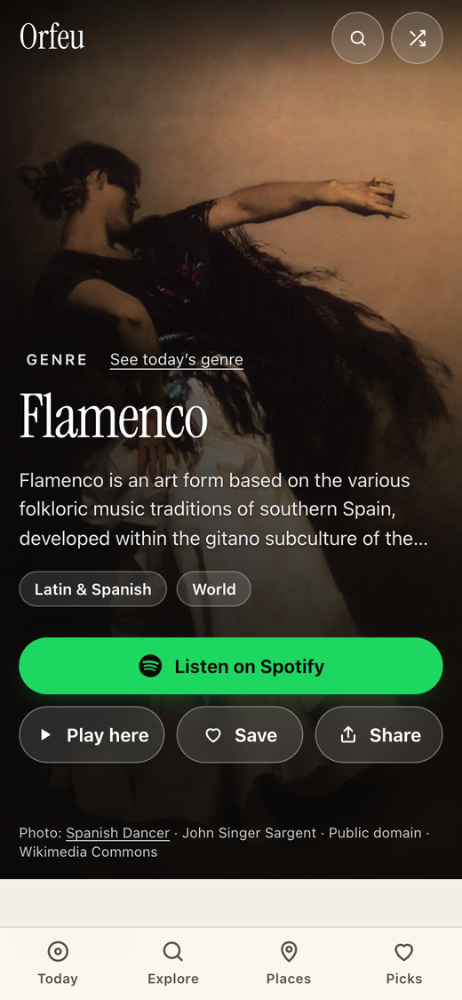
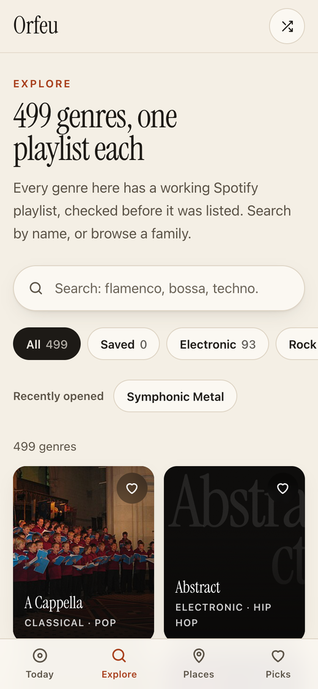
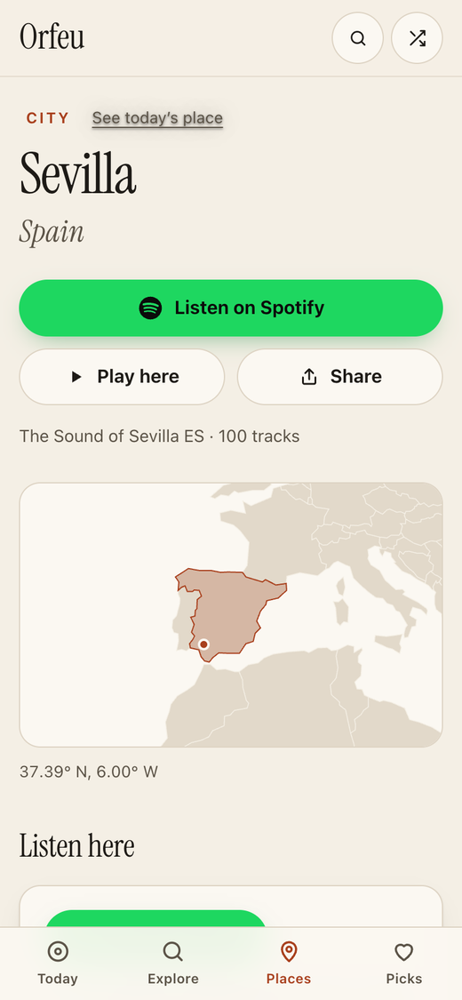

# Orfeu

Orfeu gives you one music genre and one place to listen to every day, with a real photo of each genre from Wikimedia Commons and a Spotify playlist that has been checked to work.

**Live site:** [jerryshi042003.github.io/orfeu](https://jerryshi042003.github.io/orfeu/)

<p>
  
  
  
</p>

## What it does

- **Today.** The genre of the day fills the screen with a freely licensed photo from Wikipedia / Wikimedia Commons, the opening of its Wikipedia article and its "The Pulse of …" playlist. The arrows step back through earlier days. Below: the full introduction, playlist details, genres close to this one, and the last seven days.
- **Explore.** Search all 499 genres (accents and capitals ignored, old names included), filter by family (Rock, Electronic, Brazilian, Latin & Spanish, Jazz & blues, …) or by the genres you saved, and see what you opened recently.
- **Places.** The place of the day (one of 677 cities and countries) with its "The Sound of …" playlist, a map, the nearest other places, and an atlas of every place with search.
- **Jerry's picks.** The genres Jerry loves, flamenco first. Funk bruxaria has no playlist of its own, so its card says so and links the nearest one (Funk Carioca).
- **Surprise me** opens a random genre (or press <kbd>R</kbd>). **Play here** loads Spotify's player in the page; **Share** uses the phone's share sheet or copies the link; **Save** keeps a genre in this browser.
- Keyboard: <kbd>←</kbd> <kbd>→</kbd> change the day, <kbd>/</kbd> searches.

### Links

| Link | Shows |
|---|---|
| `/` | Today's genre |
| `/?date=2026-10-18` | The genre for that day (past days only) |
| `/g/flamenco/` | One genre. These pages are prebuilt so a shared link previews with the genre's photo. `/?g=flamenco` works too. |
| `/explore/?q=bossa&f=brazilian` | Explore with a search and a family filter |
| `/locations/`, `/locations/?date=…`, `/locations/?p=sevilla` | Today's place, a past day's place, one place |
| `/picks/` | Jerry's picks |

Everyone sees the same pick on the same calendar day. The picks come from `assets/data/schedule.json`, which fixes the genre and place for every date from 2025-01-01 to 2028-12-28. Dates up to 2026-10-21 reproduce what the site showed before the schedule existed, so old `?date=` links still show the same thing. The file is only ever extended.

## The playlist audit

Every playlist is checked before it is listed (`pipeline/audit-playlists.mjs`, report in `pipeline/reports/playlists-audit.json`). A playlist passes when:

1. Spotify's oEmbed endpoint answers for it (a 404 counts only after three tries);
2. its embed player lists at least 20 tracks and at least 70% of them are playable (checked three times before failing);
3. its title still names the genre or place. If Spotify renamed it, the genre takes the new name.

The last audit ran on 21 October 2026 over 1,227 playlists (all genres, all places, and the three extra genres the picks use):

- **Cut, genres (15):** Bemani and Screamocore (playlists deleted); Japanoise (1 track left), Musique Concrète (6), Skiffle (6), Free Improvisation (7, 4 playable), Electronica (9; now "Indie Electronica"), Alternative Hardcore (10), Cabaret (11), Zeuhl (11), Comedy Rock (12), Freak Folk (13), Mashup (14), Spoken Word (18), Accordion (19).
- **Cut, places (36):** 16 playlists deleted (Concord AU, Estonia, Hellerup, Kaufman, Lithuania, Lohja, Måløv, Mugla, Oldham, Omaha, Palmas, Romford, Slovakia, Tullinge, Turku, Worthing) and 20 with too few tracks or too few playable ones (Ames, Annerley, Ashburn, Athens GA, Aurich, Bloomington, Bottrop, Carlton, Clifton, Diemen, Elizabeth, Ithaca, Meppen, Norwalk, Prahran, Richardson, San Pablo City, Santa Clara, Stockport, Tlaquepaque).
- **Renamed (29)** to the playlist's current title, for example Forro → Forró, Mandopop → Classic Mandopop, Pipe Band → Bagpipe, Neoclassical → Neoclassical Darkwave, Baile Funk → Funk das Antigas. Old names still find them in search. Ten Australian places gained their state in the title (Adelaide → Adelaide, South Australia).

Spotify can delete or rename these playlists at any time, so run the audit again before publishing.

## Photos

Each genre's photo is chosen by `pipeline/build-images.mjs` from, in order: a reviewed override (`pipeline/image-overrides.json`), the Wikipedia article's lead image, the Wikidata image, the article's other images, and, only when those give nothing usable, the genre's Commons category. Only files on Wikimedia Commons with a free licence (public domain, CC0, CC BY, CC BY-SA and similar) are used; maps, logos, scores, diagrams and very small files are skipped, and no photo appears on two genres (when two genres share an article, the second gets the next photo or the poster). Every automatic pick was reviewed by eye on 2026-10-21: twelve files (sheet music, diagrams, a logo and the like) are excluded, and the next candidate is used where there is one; twelve genres show the poster instead of a weak photo; and 35 photos were chosen by hand. Five are for the picks (Flamenco, Cante Flamenco, Pagode, Funk Carioca, Funk das Antigas). Three replace weak automatic picks (Ostrock, Alternative Pop, Chicago Blues). The other 27 give a photo to a genre that had none, mostly the lead image of the same article in another language's Wikipedia (for example Harp, Vallenato, Djent, Minimalism, Vocal Jazz).

404 of the 499 genres have a photo. The other 95 show a drawn poster in a colour of their own. Every photo is credited under the picture and linked to its Commons page; [CREDITS.md](CREDITS.md) lists them all.

## Privacy

There are no accounts, cookies or analytics. The page loads its photos from `upload.wikimedia.org`. Nothing from Spotify loads until you press **Play here** or **Load the player** (Spotify's player then uses Spotify's cookies). Saved and recently opened genres are kept in your own browser's storage and never leave it.

## How it works

The site is plain HTML, CSS and JavaScript served by GitHub Pages from the `main` branch. Nothing is built at deploy time.

```
index.html              Today: the genre of the day (also ?date= and ?g=)
g/<slug>/index.html     One page per genre, generated from index.html
explore/index.html      Search and browse every genre
locations/index.html    Place of the day, map, nearby places, atlas
picks/index.html        Jerry's picks
404.html                Not-found page
assets/css/orfeu.css    All styles
assets/js/core.js       Data, dates and schedule, saved/recent, share, player, header
assets/js/genre.js      Today and genre pages
assets/js/explore.js    Explore
assets/js/places.js     Places
assets/js/picks.js      Jerry's picks
assets/data/            genres.json, locations.json, schedule.json, favourites.json
assets/map/world.svg    World map
assets/fonts/           Instrument Serif (SIL Open Font License, see OFL.txt)
pipeline/               Scripts and source lists that produce assets/data, g/ and CREDITS.md
docs/                   Screenshots used in this README
```

### Data

The genre and place lists were collected from [Every Noise at Once](https://everynoise.com) and a public dump of Spotify-generated playlists (`pipeline/notebooks/Orfeu_For_Publish.ipynb`, outputs in `pipeline/source/`). The genres are the 511 in `filteredPulse.csv` that passed the audit, plus three from `thePulseOf.csv` that the picks need (`pipeline/extra-genres.json`): Cante Flamenco, Pop Flamenco and Classical Piano.

- `audit-playlists.mjs` checks every playlist (about 15 minutes; requests are paced 0.3 s apart).
- `build-genres.mjs` drops what the audit cut, renames what Spotify renamed, finds a Wikipedia article that is actually about the music (not a disambiguation page, a band, a magazine or a record label; reviewed exceptions in `wiki-overrides.json`), and adds slugs and families.
- `build-images.mjs` picks each genre's photo, checks its thumbnail, and writes `CREDITS.md`.
- `build-locations.mjs` drops what the audit cut, geocodes each place with OpenStreetMap Nominatim (cached in `geocode-cache.json`) and draws `world.svg` from Natural Earth.
- `build-pages.mjs` extends `schedule.json` and writes the `g/<slug>/` pages.

## Run it locally

```sh
python3 -m http.server 8000
# open http://localhost:8000/
```

## Refresh the data

Requires Node 18 or later.

```sh
cd pipeline
npm install
npm run build        # audit, genres, images, locations, pages
```

Review `pipeline/reports/` and the diff in `assets/data/` before committing. Pushing to `main` publishes the site.

## Credits

- Playlists: Every Noise at Once by Glenn McDonald, on Spotify.
- Genre introductions: Wikipedia, CC BY-SA 4.0. Each one links to its article.
- Photos: Wikimedia Commons contributors, under the licence shown with each photo ([CREDITS.md](CREDITS.md)).
- Map: Natural Earth (public domain), via world-atlas. Place coordinates: © OpenStreetMap contributors, ODbL.
- Typeface: Instrument Serif, SIL Open Font License 1.1.

## Name

Orfeu is the Brazilian Portuguese form of Orpheus, the musician and poet of Greek myth.
